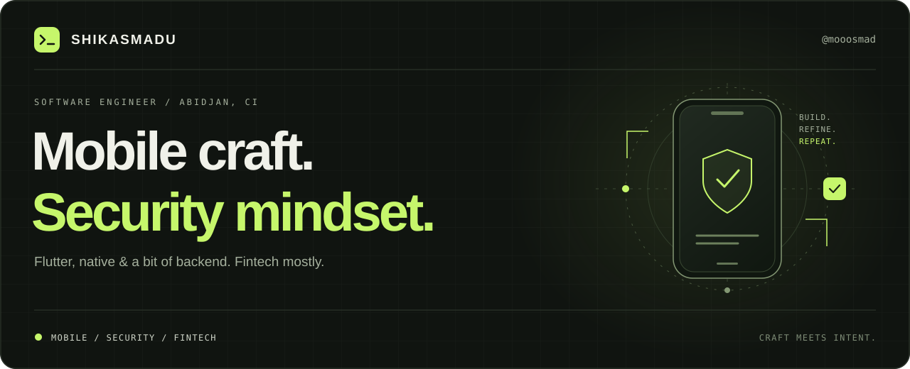

  

  <a href="https://www.linkedin.com/in/sangare-mohamed-81a662155/">LinkedIn</a> &nbsp;↗&nbsp;&nbsp;·&nbsp;&nbsp;
  <a href="https://gitlab.com/mooosmad">GitLab</a> &nbsp;↗&nbsp;&nbsp;·&nbsp;&nbsp;
  <a href="https://github.com/mooosmad?tab=repositories">Explore my code</a> &nbsp;↗

 

### A little context

I'm **Shikasmadu**, a software engineer based in **Abidjan, Côte d’Ivoire** 🇨🇮.
I build mobile apps with **Flutter and native technologies**, work across a bit of backend, and spend most of my time in **fintech**. Security is part of how I think about software.

 

| 01 / Mobile | 02 / Security | 03 / Fintech |
| :--- | :--- | :--- |
| Thoughtful interfaces. Flutter & native development. | A security mindset. Attention to what happens beneath the UI. | Real-world complexity. Software where trust matters. |

 

### The toolkit

**Mobile** &nbsp; / &nbsp; `Flutter` · `Dart` · `Swift`

**Web & backend** &nbsp; / &nbsp; `TypeScript` · `React` · `PHP` · `Python` · `Firebase`

**Workflow** &nbsp; / &nbsp; `Git` · `GitHub` · `GitLab` · `Figma` · `Linux` · `Vim`

 

---

  ABIDJAN, CI &nbsp; / &nbsp; MOBILE · SECURITY · FINTECH

  
Community activity

   
  

